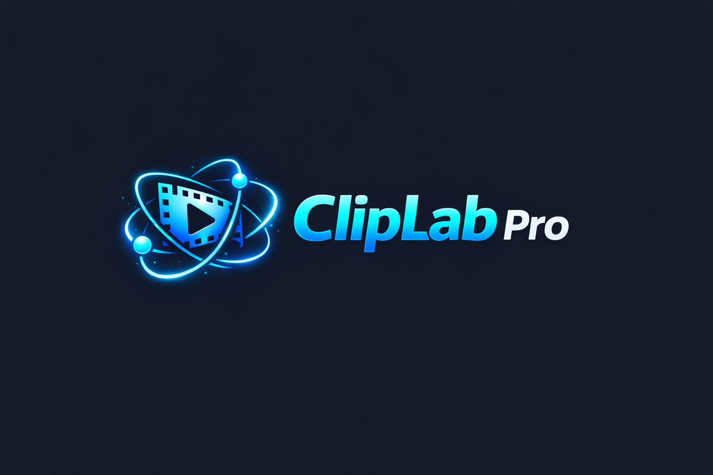
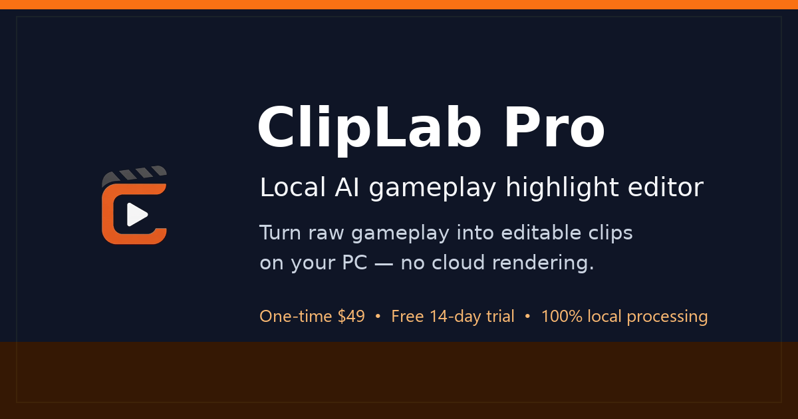
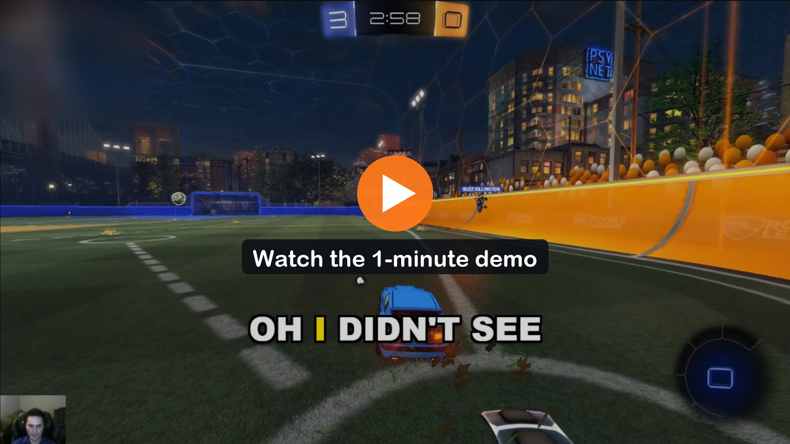
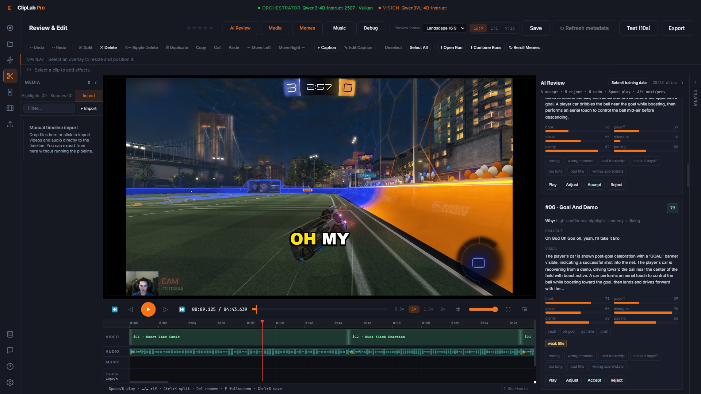
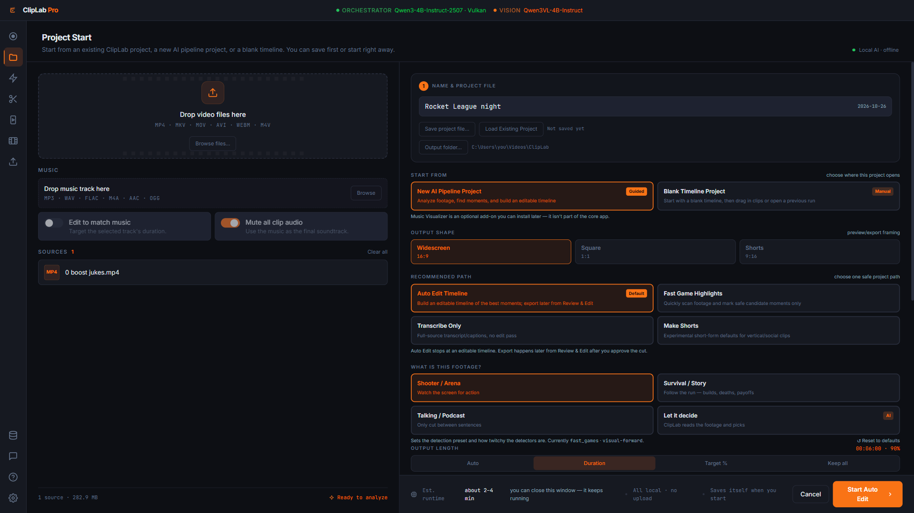
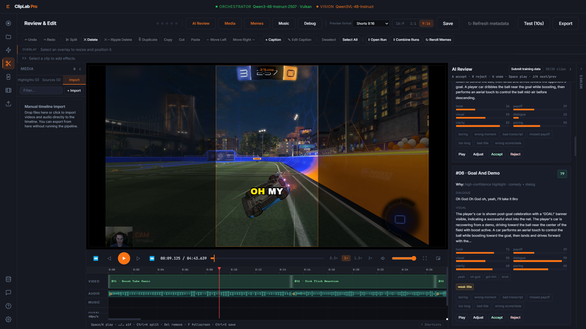
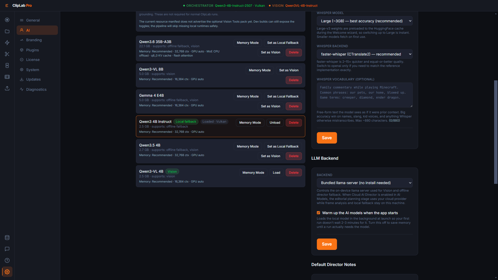

<p align="center">
  
</p>

<h1 align="center">ClipLab Pro</h1>

<p align="center">
  Raw gameplay footage in, finished YouTube videos and Shorts out.<br>
  Processed on your own PC. No cloud required, no footage uploaded, no subscription to someone else's GPU.
</p>

<p align="center">
  <a href="https://cliplabpro.com">cliplabpro.com</a> ·
  <a href="#demo">Demo</a> ·
  <a href="#how-it-works">How it works</a> ·
  <a href="#engineering-highlights">Engineering highlights</a>
</p>

---

<p align="center"></p>

## What it is

ClipLab Pro is a Windows desktop app for gamers and small creators. You point it at a
recording, from a ten-minute match to a long 4K HDR session, and it:

- finds the moments worth watching from what was said, how loud it got and what was on screen;
- plans an edit, with a cold open, tight cuts and punch-ins;
- writes word-by-word captions in the style of big YouTube channels;
- cuts vertical Shorts with their own framing and pacing (beta);
- drafts titles, descriptions, tags and thumbnails;
- hands everything to a built-in editor, so a person approves every cut before the final render.

Processing runs on your own PC with open local models, using your GPU where it can. Your
recordings are never uploaded for processing. Optional, and off unless you turn them on:

- a bring-your-own-key Cloud Director (beta) that sends metadata, transcripts, scores and
  local frame descriptions (never frames, video or audio) to OpenAI, Anthropic or an
  OpenAI-compatible endpoint you choose, for edit planning;
- training feedback: scores, model names and your accept/reject decisions, with no footage
  or transcript;
- direct upload of a finished video to your YouTube channel.

This repository is a showcase. The source code is private; this page describes what the
product does and how it was built.

## Demo

<p align="center">
  <a href="https://cdn.jsdelivr.net/gh/efenn-dev/cliplab-showcase@d7f3b542d16e948d49606a2d7bf762e8fc1d448f/media/cliplab-demo.mp4"></a>
</p>

One minute, recorded in the app on real Rocket League footage: set up a project, then
review a finished run's cut with word-by-word captions, see why each clip was picked,
switch to a vertical preview, and check the local models doing the work.

<p align="center">
  <br>
  <sub><b>Review & Edit.</b> The cut on a timeline, captions timed word by word, and the reasoning behind each clip: what was said, what the vision model saw, and the scores.</sub>
</p>

| | |
|---|---|
| <br><sub><b>Project setup.</b> Drop in a recording, pick the output shape and what kind of footage it is.</sub> | <br><sub><b>Vertical preview.</b> One click reframes the same edit and captions for 9:16.</sub> |
| <br><sub><b>Local models.</b> Qwen3 4B plans the edit, Qwen3-VL 4B watches the footage and Whisper transcribes, all on your own PC through a bundled llama.cpp server.</sub> | |

<sub>The gameplay is the author's own Rocket League footage. Rocket League is a trademark of
Psyonix LLC. ClipLab Pro is not affiliated with or endorsed by Psyonix, Epic Games, YouTube,
TikTok, NVIDIA or Blackmagic Design.</sub>

## How it works

```
Recording(s) ──► Collect & sync ──► Highlight detection ──► Edit director ──► Assemble & brand
                 (multi-camera,      (Whisper transcript,     (local LLM or      (intro/outro, logo,
                  audio fingerprint)  loudness, scene          deterministic       picture-in-picture)
                                       changes, vision model)   rules)
                                                                         │
     Editor (human review) ◄── Export & manifest ◄── Metadata ◄── Thumbnails ◄── Captions
     cuts, captions, FX, Shorts   OTIO / FCPXML / EDL   titles,      generated     word-level
     final render on approval     timelines             tags         frames        timing
```

Two halves, two repositories:

- **The app** is Electron + React. It owns the installer, the editor, the export renderer,
  licensing, signed updates and the managed `llama.cpp` server.
- **The pipeline** is Python, nine numbered stages behind one orchestrator. It is delivered
  to users as two signed downloads: a large runtime that rarely changes, and a small code
  bundle that can update in seconds without reinstalling.

### Stack

| Layer | Technology |
|---|---|
| Desktop shell | Electron, React, Tailwind |
| Pipeline | Python 3.12 on an embedded interpreter |
| Local LLM | `llama.cpp` server, Qwen3 4B for planning, Qwen3-VL for vision |
| Speech | faster-whisper with word timestamps |
| Video | FFmpeg with NVENC and NVDEC, OpenCV |
| Timelines | OpenTimelineIO, FCPXML, EDL |
| Updates | Signed manifests on a self-hosted CDN |

## Engineering highlights

**Local-first by construction.** The installer is a thin shell. On first launch it pulls
FFmpeg, the model server and the pipeline, each checked against an Ed25519-signed manifest
before it is trusted. Model weights download from their official Hugging Face repositories.
Updates to the app and to the pipeline are signed the same way. Crash reports stay on disk
unless the user clicks Upload.

**A human approves the final cut.** Detection, planning and captioning all run
automatically, but the result lands in an editor, and the final render waits for approval.
Captions are tied to the source clock, so trimming a clip in the editor never slides its
captions out of sync.

**HDR footage that doesn't come out grey.** 10-bit HDR recordings from OBS used to
export washed out. The tone-mapping chain was chosen by measurement: several curves and
two backends were compared by PSNR against the original SDR clips after an HDR round
trip, and the winner is used for detection, thumbnails, preview proxies and the final
export.

**4K60 AV1 sessions on a consumer GPU.** Long high-resolution sessions decode through
NVDEC into a low-resolution scene proxy, so detection stays fast. The assembly step scales
its time budget to the frame count and falls back to a simpler concatenation instead of
failing.

**Multi-camera Shorts.** Recordings from two PCs of the same session are aligned by
matching the words both recordings heard (within 50 ms on our test session), so a Short
can cut between players' points of view.

**Highlight library.** Folders of old footage can be scanned once into a local database,
then browsed by event type, such as clutch saves or funny moments, without re-running
detection.

**NLE handoff.** The AI's cut exports as an OpenTimelineIO, FCPXML or EDL timeline that
points at the original full-quality recordings, ready to finish in an editor such as
DaVinci Resolve.

**Signed plugins.** The pipeline loads effect plugins only after verifying a signed
manifest covering every source and asset file in the plugin, so a tampered or extra file
is refused.

**Tested.** About 1,650 app tests run in CI on every push. About 1,900 pipeline tests and
a headless smoke crawl of every app page run before releases.

## Status

ClipLab Pro is in public beta on Windows. An NVIDIA GPU is recommended for full speed;
without one, the heavy steps fall back to the CPU. The signed installer and license keys
are available at [cliplabpro.com](https://cliplabpro.com).

## Contact

Built by Emmitt Fennessey under Agency Edge LLC.

- Product: [cliplabpro.com](https://cliplabpro.com)
- Business and partnerships: intel@agencyedge.io
- Source access for serious partners is available on request.
